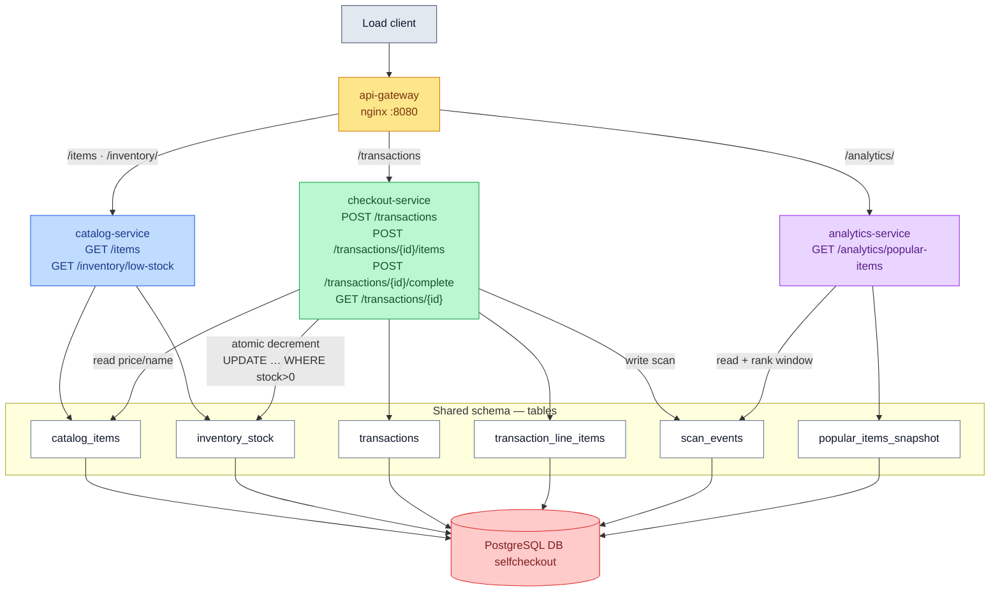
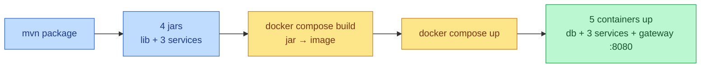

# Service-Based Architecture

Coarse-grained **domain services** decomposed by business function, each an
independently deployable container, sharing **one centralized database**.


## Services

- **catalog-service** (Spring Boot) — owns `catalog_items` and `inventory_stock`; serves `GET /items` and `GET /inventory/low-stock`.
- **checkout-service** (Spring Boot) — owns `transactions` and `transaction_line_items`; serves `POST /transactions`, `/{id}/items`, `/{id}/complete`, and `GET /transactions/{id}`.
- **analytics-service** (Spring Boot) — owns `popular_items_snapshot`; serves `GET /analytics/popular-items`.


## Routing

The api-gateway at (`:8080`) path-routes each endpoint to the
corresponding service.

- `/items`, `/inventory/low-stock` → **catalog-service**
- `/transactions*` → **checkout-service**
- `/analytics/popular-items` → **analytics-service**

## Database access

`shared-persistence` is a thin library holding **only** the entities/repositories
for tables touched by more than one service:

- `catalog_items` — read by catalog, checkout, analytics
- `inventory_stock` — written by checkout, read by catalog
- `scan_events` — written by checkout, read by analytics


## Topology




## Building and Running Different Services



Each service compiles to a Spring Boot fat jar (with `shared-persistence` bundled
in); `docker compose build` copies each jar into its own image; `docker compose
up` starts Postgres (which runs schema + seed on first init), then the services
once the DB is healthy, then the gateway.

```bash
# 1. Build all jars (host)
cd service-based
mvn -DskipTests package

# 2. Build images and start db + 3 services + gateway
docker compose up --build         # add -d to detach

# 3. Point the load client at the gateway
cd ../load-client
./build.sh
./run.sh --baseUrl=http://localhost:8080 --stations=10 --duration=60
```

Fresh, reseeded database each run:

```bash
docker compose down && docker compose up --build
```

