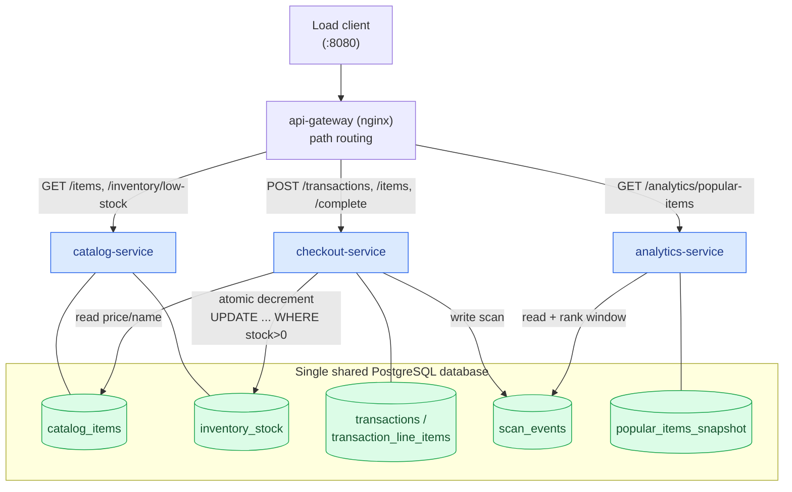

# Week 4 — Service-Based Architecture

Coarse-grained **domain services** decomposed by business function, each an
independently deployable container, all sharing **one centralized database**.
Services do **not** call each other — inter-domain coupling lives at the
database-access layer. The external HTTP contract is unchanged, so the same
unmodified load client drives this week as every other.

> Full requirements and design: [`specs/003-service-based-architecture/`](../specs/003-service-based-architecture/)
> (spec.md, plan.md, research.md).

## Services

| Deployable unit | Kind | Owns (tables) | Endpoints |
| --- | --- | --- | --- |
| **api-gateway** | nginx | — | single entry `:8080`, path-routes to services |
| **catalog-service** | Spring Boot | `catalog_items`, `inventory_stock` | `GET /items`, `GET /inventory/low-stock` |
| **checkout-service** | Spring Boot | `transactions`, `transaction_line_items` | `POST /transactions`, `/{id}/items`, `/{id}/complete`, `GET /transactions/{id}` |
| **analytics-service** | Spring Boot | `popular_items_snapshot` | `GET /analytics/popular-items` |
| *shared-persistence* | library (not a service) | the cross-boundary DAOs | — |

## Topology



**No arrow goes service → service.** Every cross-domain interaction is a database
access (solid/▸ to a table). The only HTTP hops are gateway → service.

## The two sharp edges

1. **Stock decrement** (`checkout-service` → `inventory_stock`): a single atomic
   `UPDATE inventory_stock SET stock = stock - 1 WHERE sku = ? AND stock > 0`
   inside the Checkout service's own completion transaction, backed by
   `CHECK (stock >= 0)`. The check-and-decrement is one statement, so there is no
   cross-service race window and the "stock never negative /
   `initial − final = sold`" invariant is preserved exactly as in the monolith.
2. **Analytics ingestion** (`checkout-service` → `scan_events` → `analytics-service`):
   Checkout writes a scan row per scan; Analytics recomputes the hopping window
   (size 1000, slide 500) on a schedule and serves the latest snapshot. No call
   in either direction.

## How the shared DB access is distributed

`shared-persistence` is a thin library holding **only** the entities/repositories
for tables touched by more than one service:

- `catalog_items` — read by catalog, checkout, analytics
- `inventory_stock` — written by checkout, read by catalog
- `scan_events` — written by checkout, read by analytics

Single-owner tables (`transactions`, `transaction_line_items`,
`popular_items_snapshot`) stay **private** to their service. Each service declares
an explicit `@EntityScan`/`@EnableJpaRepositories` footprint, so its data-domain
reach is visible in code. The database **owns the schema** (`data/init/*.sql`, run
once at container init); services run `ddl-auto: none`.

## Build & run

Requires JDK 21 and Docker Desktop.

```bash
# 1. Build all service jars (host)
cd service-based
mvn -DskipTests package

# 2. Build images and start db + 3 services + gateway
docker compose up --build        # add -d to detach

# 3. Point the load client at the gateway
cd ../load-client
./build.sh
./run.sh --baseUrl=http://localhost:8080 --stations=10 --duration=60
```

A fresh, reseeded database each run:

```bash
docker compose down && docker compose up --build
```

Independent deployability demos:

```bash
docker compose restart checkout-service          # others keep serving
docker compose up -d --scale checkout-service=2   # scale one hot service
```

Direct per-service access (debugging, bypassing the gateway):
catalog `:8081`, checkout `:8082`, analytics `:8084`, Postgres `:5432`.

## Deliverables (assignment)

- **Services list (1 pt):** the four deployable units above (3 domain services + gateway).
- **Default-run report (2 pts):** `quality-attribute-analysis/default.json` —
  `./run.sh --stations=10 --duration=60`.
- **Stress-run report (2 pts):** `quality-attribute-analysis/stressMode.json` —
  `./run.sh --stations=100 --duration=120` (`java -cp out Main --stations=100 --duration=120`).

After each run, verify the invariant: for every SKU,
`10000 − final_stock` equals the completed line items for that SKU, and no stock is negative.

## Status

Scaffold complete and compiling (`mvn package` produces all four jars). Service
logic for the full flow is implemented. Not yet executed end-to-end against the
load client — that run produces the two report JSONs above.
